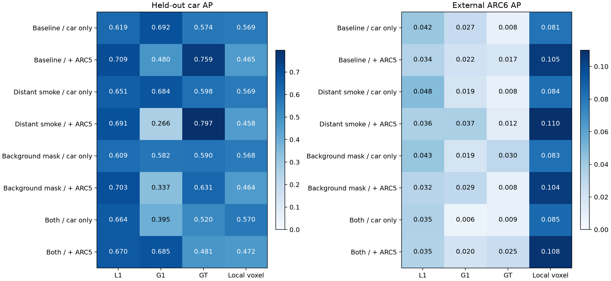

# Car options and ARC6 results, 27 November 2026

All 32 experiments completed. Every run includes an inference bundle, best and last checkpoints, resolved configuration and split, normalization, training history, calibration plot, selection report, and car and ARC6 test reports. No run hit its four-hour ceiling.

The highest observed ARC6 average precision was 0.1099, from local voxel with distant-smoke augmentation and ARC5. Its precision was 0.0958, recall 0.4242, and F1 0.1563 at the car-selected threshold.



These are descriptive comparisons on the external test recordings. Selection and probability calibration used the car partitions, and operating thresholds came from car selection. ARC6 was used for the final comparison. GT scores 3,581 ARC6 frames and 46,916,532 points. The other models score 3,609 frames and 47,283,015 points because they require no five-frame warm-up. Car labels are the surface-v2 pilot, with automatic revisions still requiring annotation review. See [dataset documentation](dataset-documentation/README.md).

Training used seed 20260920, at most 30 epochs and 1,400 supervised optimizer steps per epoch, with patience 5. The queue initially ran sequentially, then with two and three workers. Configurations, scheduling records, benchmark timings, source snapshot, and environment versions are preserved. This is one seed per configuration.

[Downloadable summary CSV](analysis_summary.csv) and [full comparison CSV](comparison.csv) contain all results. The table below is ordered by model and recipe. Scores are fractions. Each model link opens its run directory.

| Model | Recipe | Best / total epochs | Car AP | Car F1 | ARC6 AP | ARC6 F1 | ARC6 precision | ARC6 recall |
| --- | --- | ---: | ---: | ---: | ---: | ---: | ---: | ---: |
| [l1](car-options-arc6-20261127-l1-a_baseline_car_only/) | a_baseline_car_only | 1 / 6 | 0.6185 | 0.5610 | 0.0422 | 0.0302 | 0.0155 | 0.5972 |
| [l1](car-options-arc6-20261127-l1-a_baseline_with_arc5/) | a_baseline_with_arc5 | 1 / 6 | 0.7086 | 0.5676 | 0.0338 | 0.0459 | 0.0242 | 0.4610 |
| [l1](car-options-arc6-20261127-l1-b_distant_smoke_car_only/) | b_distant_smoke_car_only | 1 / 6 | 0.6512 | 0.5526 | 0.0480 | 0.0298 | 0.0153 | 0.5794 |
| [l1](car-options-arc6-20261127-l1-b_distant_smoke_with_arc5/) | b_distant_smoke_with_arc5 | 1 / 6 | 0.6911 | 0.5562 | 0.0362 | 0.0522 | 0.0277 | 0.4452 |
| [l1](car-options-arc6-20261127-l1-c_background_mask_car_only/) | c_background_mask_car_only | 1 / 6 | 0.6085 | 0.5570 | 0.0430 | 0.0291 | 0.0149 | 0.6041 |
| [l1](car-options-arc6-20261127-l1-c_background_mask_with_arc5/) | c_background_mask_with_arc5 | 1 / 6 | 0.7031 | 0.5700 | 0.0324 | 0.0458 | 0.0241 | 0.4509 |
| [l1](car-options-arc6-20261127-l1-d_both_car_only/) | d_both_car_only | 1 / 6 | 0.6645 | 0.5517 | 0.0352 | 0.0276 | 0.0141 | 0.5868 |
| [l1](car-options-arc6-20261127-l1-d_both_with_arc5/) | d_both_with_arc5 | 1 / 6 | 0.6702 | 0.5524 | 0.0346 | 0.0520 | 0.0277 | 0.4224 |
| [g1](car-options-arc6-20261127-g1-a_baseline_car_only/) | a_baseline_car_only | 8 / 13 | 0.6915 | 0.6812 | 0.0271 | 0.0414 | 0.0235 | 0.1734 |
| [g1](car-options-arc6-20261127-g1-a_baseline_with_arc5/) | a_baseline_with_arc5 | 5 / 10 | 0.4795 | 0.5179 | 0.0223 | 0.0508 | 0.0273 | 0.3653 |
| [g1](car-options-arc6-20261127-g1-b_distant_smoke_car_only/) | b_distant_smoke_car_only | 27 / 30 | 0.6836 | 0.5848 | 0.0194 | 0.0412 | 0.0224 | 0.2519 |
| [g1](car-options-arc6-20261127-g1-b_distant_smoke_with_arc5/) | b_distant_smoke_with_arc5 | 4 / 9 | 0.2661 | 0.3777 | 0.0366 | 0.1040 | 0.0856 | 0.1322 |
| [g1](car-options-arc6-20261127-g1-c_background_mask_car_only/) | c_background_mask_car_only | 8 / 13 | 0.5822 | 0.6247 | 0.0191 | 0.0523 | 0.0313 | 0.1583 |
| [g1](car-options-arc6-20261127-g1-c_background_mask_with_arc5/) | c_background_mask_with_arc5 | 4 / 9 | 0.3371 | 0.4286 | 0.0295 | 0.0778 | 0.0553 | 0.1316 |
| [g1](car-options-arc6-20261127-g1-d_both_car_only/) | d_both_car_only | 1 / 6 | 0.3950 | 0.4348 | 0.0060 | 0.0108 | 0.0055 | 0.2937 |
| [g1](car-options-arc6-20261127-g1-d_both_with_arc5/) | d_both_with_arc5 | 16 / 21 | 0.6853 | 0.5641 | 0.0200 | 0.0337 | 0.0176 | 0.4296 |
| [gt](car-options-arc6-20261127-gt-a_baseline_car_only/) | a_baseline_car_only | 16 / 21 | 0.5744 | 0.5149 | 0.0080 | 0.0171 | 0.0087 | 0.4227 |
| [gt](car-options-arc6-20261127-gt-a_baseline_with_arc5/) | a_baseline_with_arc5 | 20 / 25 | 0.7586 | 0.6038 | 0.0173 | 0.0387 | 0.0216 | 0.1835 |
| [gt](car-options-arc6-20261127-gt-b_distant_smoke_car_only/) | b_distant_smoke_car_only | 16 / 21 | 0.5983 | 0.5524 | 0.0085 | 0.0177 | 0.0090 | 0.4472 |
| [gt](car-options-arc6-20261127-gt-b_distant_smoke_with_arc5/) | b_distant_smoke_with_arc5 | 16 / 21 | 0.7968 | 0.5768 | 0.0121 | 0.0262 | 0.0140 | 0.2156 |
| [gt](car-options-arc6-20261127-gt-c_background_mask_car_only/) | c_background_mask_car_only | 9 / 14 | 0.5903 | 0.5838 | 0.0303 | 0.0806 | 0.0473 | 0.2734 |
| [gt](car-options-arc6-20261127-gt-c_background_mask_with_arc5/) | c_background_mask_with_arc5 | 14 / 19 | 0.6306 | 0.6323 | 0.0083 | 0.0199 | 0.0103 | 0.3408 |
| [gt](car-options-arc6-20261127-gt-d_both_car_only/) | d_both_car_only | 16 / 21 | 0.5200 | 0.5562 | 0.0085 | 0.0183 | 0.0094 | 0.3591 |
| [gt](car-options-arc6-20261127-gt-d_both_with_arc5/) | d_both_with_arc5 | 4 / 9 | 0.4814 | 0.5320 | 0.0253 | 0.0243 | 0.0125 | 0.4438 |
| [voxel](car-options-arc6-20261127-voxel-a_baseline_car_only/) | a_baseline_car_only | 1 / 6 | 0.5694 | 0.5752 | 0.0814 | 0.0661 | 0.0354 | 0.4893 |
| [voxel](car-options-arc6-20261127-voxel-a_baseline_with_arc5/) | a_baseline_with_arc5 | 1 / 6 | 0.4648 | 0.4980 | 0.1051 | 0.1443 | 0.0858 | 0.4537 |
| [voxel](car-options-arc6-20261127-voxel-b_distant_smoke_car_only/) | b_distant_smoke_car_only | 1 / 6 | 0.5693 | 0.5738 | 0.0837 | 0.0636 | 0.0340 | 0.5034 |
| [voxel](car-options-arc6-20261127-voxel-b_distant_smoke_with_arc5/) | b_distant_smoke_with_arc5 | 1 / 6 | 0.4578 | 0.4966 | 0.1099 | 0.1563 | 0.0958 | 0.4242 |
| [voxel](car-options-arc6-20261127-voxel-c_background_mask_car_only/) | c_background_mask_car_only | 1 / 6 | 0.5676 | 0.5744 | 0.0829 | 0.0649 | 0.0347 | 0.4943 |
| [voxel](car-options-arc6-20261127-voxel-c_background_mask_with_arc5/) | c_background_mask_with_arc5 | 1 / 6 | 0.4640 | 0.4957 | 0.1044 | 0.1412 | 0.0834 | 0.4591 |
| [voxel](car-options-arc6-20261127-voxel-d_both_car_only/) | d_both_car_only | 1 / 6 | 0.5699 | 0.5754 | 0.0855 | 0.0669 | 0.0358 | 0.4992 |
| [voxel](car-options-arc6-20261127-voxel-d_both_with_arc5/) | d_both_with_arc5 | 1 / 6 | 0.4722 | 0.4992 | 0.1079 | 0.1427 | 0.0847 | 0.4525 |

The committed files contain the complete result reports and model artifacts. The separate local transfer archives in `runs/` also package the datasets, which total about 1.7 GiB and stay outside version control. Per-point predictions can be regenerated using the saved bundles and datasets.

To reproduce an ARC6 evaluation from the repository root after transferring `data/training/unified_v1/`, run:

```bash
python -m smoke_trainer.cli evaluate --bundle artifacts/car-options-arc6-20261127/car-options-arc6-20261127-voxel-b_distant_smoke_with_arc5/bundle.pt --manifest data/training/unified_v1/dataset_manifest.json --split artifacts/car-options-arc6-20261127/arc6_split.json --partition test --output arc6_repeat.json --device cpu
```

For a car test, use `data/training/car_training_options_v1/dataset_manifest.json` and the chosen run directory's `split.json`. The original Windows absolute paths in training configs need adjustment for new or resumed training on another machine. Bundles load on CPU or CUDA independently of those paths.

Final verification checked dataset hashes, all split hashes, required artifacts, thresholds, report support, and loading all 32 bundles on CPU. [Verification report](final_verification.json) records the checks. [SHA256SUMS](SHA256SUMS) covers every exported file except itself.
